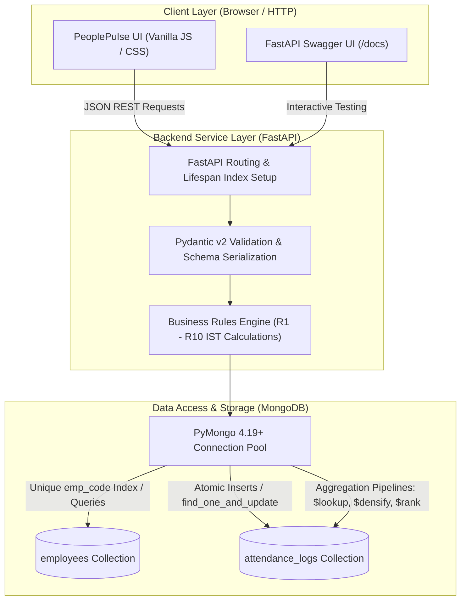
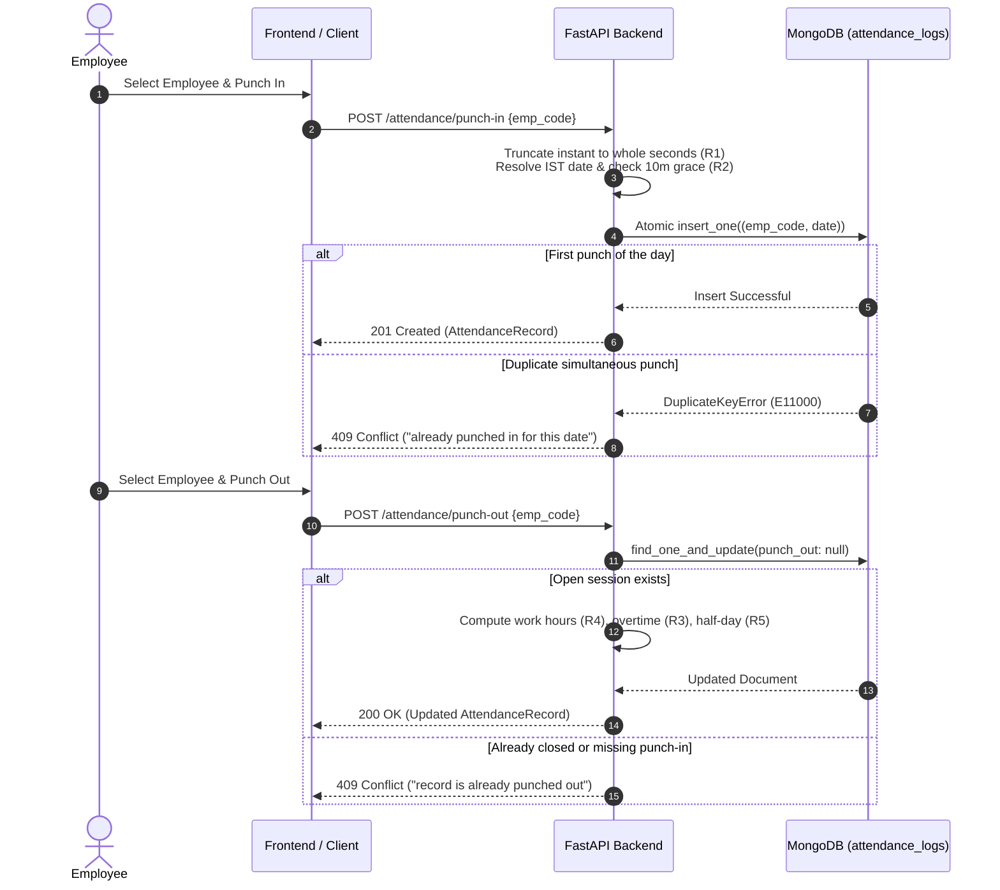

# PeoplePulse — Employee Attendance & Analytics System

> A robust, contract-compliant backend service and interactive management dashboard built with FastAPI, PyMongo, MongoDB, and Vanilla HTML/CSS/JavaScript for the HROne Software Engineer Trainee assignment.

---

## 1. Project Title & Description
**PeoplePulse: Employee Attendance & Analytics System** is a full-stack solution designed for workforce attendance tracking, shift compliance, manual regularization with immutable audit trails, and multi-dimensional HR analytics. The system adheres strictly to the official OpenAPI 3.0 specification (`openapi.yaml`), implementing database-level race protection and optimized MongoDB aggregation pipelines.

---

## 2. Project Overview
Managing employee attendance at scale requires strict adherence to business rules, timezone precision, and concurrency safety. This project implements:
- Core employee identity management and shift assignment.
- Daily punch-in and punch-out operations governed by Indian Standard Time (IST, UTC+05:30) and whole-second truncation.
- Automated evaluation of late arrivals, overtime, and half-day status.
- Administrative regularization with an audit log tracking before-and-after values for every modified field.
- High-performance aggregation pipelines computing monthly department summaries, competition-ranked latecomer leaderboards, calendar gap-filled attendance trends, and employee monthly summaries.
- A lightweight, responsive web demonstration dashboard (PeoplePulse) with zero external build tool requirements.

---

## 3. Key Features
- **Deterministic IST Shift Calculations**: Full handling of standard shifts and overnight shifts (e.g., 22:00 to 06:00), attributing punch times correctly across midnight boundaries.
- **Atomic Concurrency Protection**: High-frequency simultaneous punch-in and punch-out requests are guarded at the storage engine level via unique indexes and atomic updates.
- **Immutable Audit Trail**: Manual corrections maintain a complete history of changes (`at`, `by`, `reason`, and modified field values) without overwriting historical logs.
- **Server-Side Aggregations**: Monthly summaries, gap-filled daily trends (`$densify`), and windowed moving averages (`$setWindowFields`) run directly within MongoDB.
- **Dual-Mode Demonstration Dashboard**: Seamlessly toggle between local client preview (**Demo mode**) and live FastAPI/MongoDB operations (**API mode**).
- **Admin Query Plan Tool**: Interactive execution benchmarking via `GET /admin/explain/{endpoint}`, proving index scan (`IXSCAN`) utilization on query plans.

---

## 4. Technology Stack
- **Backend API Framework**: Python 3.11+, FastAPI 0.115+, Pydantic v2
- **Database Engine**: MongoDB 6.0+ (Tested against MongoDB 7.0)
- **Database Driver**: PyMongo 4.19+
- **ASGI Server**: Uvicorn 0.34+
- **Frontend UI**: Vanilla HTML5, Modern CSS3 (CSS Variables, Flexbox, Grid), Vanilla JavaScript (ES6+)
- **Testing Framework**: pytest 9.1+, HTTPX (FastAPI TestClient)

---

## 5. System Architecture
The application follows a clean layered architecture with separation between client presentation, API validation, business rules calculation, and MongoDB persistence.



---

## 6. Application Workflow

### Punch-In & Punch-Out Lifecycle


---

## 7. Project Directory Structure
```text
employee-attendance-system/
├── app/
│   ├── __init__.py
│   └── main.py          # FastAPI application, routes, models, business rules, CORS
├── frontend/
│   ├── index.html       # Single-page UI (Dashboard, Employees, Attendance, Analytics, Explain)
│   └── README.md        # Frontend documentation and serving instructions
├── sample_data/
│   ├── employees.json   # Official candidate kit sample employee documents
│   └── attendance_logs.json # Official sample attendance logs
├── tests/
│   ├── test_api.py      # Automated tests for CRUD, validation, and core endpoints
│   └── test_advanced.py # Concurrency race, leaderboard ties, and edge-case tests
├── sample_seed.py       # Utility to seed sample_data JSON into MongoDB
├── demo_e2e.py          # End-to-end command-line workflow walkthrough
├── DATA_MODEL.md        # Document shapes, BSON conversions, and index strategy
├── DECISIONS.md         # Five mandatory architecture and scaling answers
├── REVIEW.md            # Log of 10 starter-code defects resolved
├── requirements.txt     # Python dependencies (application and testing)
├── .gitignore           # Git ignore rules for environments, caches, and secrets
└── README.md            # Project master documentation
```

---

## 8. Prerequisites
- **Operating System**: Windows 10/11, Linux, or macOS
- **Python**: Version 3.11 or newer
- **MongoDB**: Version 6.0 or newer (tested on MongoDB 7.0 Community Edition)
- **Web Browser**: Any modern browser (Chrome, Edge, Firefox)

---

## 9. Installation and Setup on Windows

Execute the following commands in **Windows PowerShell**:

### 1. Clone the repository and navigate into the folder:
```powershell
git clone https://github.com/prakashkmb12-afk/employee-attendance-system.git
cd employee-attendance-system
```

### 2. Create and activate a Python virtual environment:
```powershell
python -m venv .venv
.\.venv\Scripts\activate
```

### 3. Install required dependencies:
```powershell
pip install -r requirements.txt
```

---

## 10. MongoDB Configuration
Ensure MongoDB is installed and running locally on port `27017`.

- **Check local MongoDB service status**:
  ```powershell
  Test-NetConnection -ComputerName 127.0.0.1 -Port 27017
  ```
- **If using Docker on Windows**:
  ```powershell
  docker run -d --name mongo -p 27017:27017 mongo:7
  ```
- **If using MongoDB Atlas**: Provide your connection string via the `MONGO_URI` environment variable.

---

## 11. Environment Variables
The application reads configuration from system environment variables or an optional local `.env` file (which is excluded from Git via `.gitignore`):

| Variable Name | Default Value | Description |
|---|---|---|
| `MONGO_URI` | `mongodb://localhost:27017` | MongoDB connection URI |
| `MONGO_DB` | `attendance_db` | Target database name |

To set them temporarily in PowerShell:
```powershell
$env:MONGO_URI="mongodb://localhost:27017"
$env:MONGO_DB="attendance_db"
```

---

## 12. Loading Sample Data
To populate the database with the initial sample dataset from `sample_data/`:
```powershell
python sample_seed.py
```
This loads sample employee profiles and attendance documents into `attendance_db`.

---

## 13. Running the Backend
Start the FastAPI server using Uvicorn from the repository root:
```powershell
uvicorn app.main:app --port 8000 --reload
```

- **Base URL**: `http://127.0.0.1:8000`
- **Interactive Swagger Docs**: `http://127.0.0.1:8000/docs`
- **OpenAPI Schema (JSON)**: `http://127.0.0.1:8000/openapi.json`
- **Readiness Health Probe**: `http://127.0.0.1:8000/health`

---

## 14. Running the Frontend
The frontend requires no build steps or package managers. In a second PowerShell window, navigate to the `frontend/` folder and start Python's built-in HTTP server:
```powershell
cd frontend
python -m http.server 5500
```

Open your browser to:
```text
http://127.0.0.1:5500
```
The interface will automatically verify the backend readiness via `GET /health` and display **• API mode · FastAPI + MongoDB**.

---

## 15. API Documentation & Endpoint Reference

All endpoints strictly follow the official `openapi.yaml` contract:

| Category | HTTP Method | Path | Description | Response Status |
|---|---|---|---|---|
| **System** | `GET` | `/health` | Readiness probe; verifies active MongoDB ping | `200 OK` / `503 Service Unavailable` |
| **Employees** | `POST` | `/employees` | Create employee with unique `emp_code` enforcement | `201 Created` / `409 Conflict` / `422 Unprocessable` |
| **Employees** | `GET` | `/employees` | Paginated employee directory with department filter | `200 OK` (`items`, `total`, `page`, `page_size`) |
| **Attendance** | `POST` | `/attendance/punch-in` | Record punch-in, resolve overnight date (R1), evaluate grace (R2) | `201 Created` / `404 Not Found` / `409 Conflict` |
| **Attendance** | `POST` | `/attendance/punch-out` | Close session, compute work hours (R4), overtime (R3), half-day (R5) | `200 OK` / `404 Not Found` / `409 Conflict` |
| **Attendance** | `GET` | `/attendance` | Paginated records with date range and status filters | `200 OK` sorted by `(date: -1, emp_code: 1)` |
| **Attendance** | `PATCH` | `/attendance/{emp_code}/{date}` | Manual regularization, recomputes derived metrics, appends audit entry | `200 OK` / `404 Not Found` / `409 Conflict` / `422` |
| **Analytics** | `GET` | `/analytics/employees/{emp_code}/monthly` | Monthly employee summary with mid-month joiner working days (R7) | `200 OK` (`working_days`, `attendance_pct`) |
| **Analytics** | `GET` | `/analytics/departments/summary` | Department summary with R9 headcount (including zero-log employees) | `200 OK` (`headcount`, `avg_work_hours`) |
| **Analytics** | `GET` | `/analytics/leaderboard/late` | Competition-ranked late arrivals leaderboard with tie handling | `200 OK` (`$rank` standard ranking) |
| **Analytics** | `GET` | `/analytics/departments/{department}/trend` | Daily trend with database-level calendar gap-filling & 7-day MA | `200 OK` (`$densify`, `$setWindowFields`) |
| **Admin** | `GET` | `/admin/explain/{endpoint}` | Raw MongoDB `executionStats` query plan output verifying index usage | `200 OK` (`IXSCAN` plan verification) |

---

## 16. Testing and Verification

### Automated Test Suite
Run the automated tests using pytest:
```powershell
python -m pytest tests/
```
**Test Results Summary:**
- Total tests: **12 passed** in 2.52s.
- Covered areas:
  - `test_health`: MongoDB connectivity and error status codes.
  - `test_employee_crud_and_validation`: Regex pattern, shift time equality check, duplicate code handling (409).
  - `test_punch_in_and_out_flow`: Normal punch flow, grace period evaluation, overnight shift crossing midnight.
  - `test_concurrent_punch_ins`: ThreadPool race test verifying exactly one `201` and four `409` conflict responses.
  - `test_concurrent_punch_outs`: Concurrency test ensuring only one worker successfully closes an open session.
  - `test_leaderboard_ties_and_cutoff`: Verifies standard competition ranking (Rank 1, Rank 1, Rank 3).
  - `test_zero_log_headcount`: Verifies R9 headcount includes employees with zero attendance records.
  - `test_explain_ixscan`: Verifies MongoDB optimizer utilizes index scans (`IXSCAN`).

### End-to-End Walkthrough Simulation
Run the command-line integration simulation:
```powershell
$env:PYTHONIOENCODING="utf-8"
python demo_e2e.py
```
Verifies all 11 user journeys from onboarding through regularization, aggregations, and query explain.

---

## 17. Attendance Business Rules (R1 – R10)
1. **R1 Time Zone & Calendar Date**: All shift times and attendance dates are IST (UTC+05:30). If `shift_end <= shift_start` (overnight shift), punch-in earlier than `shift_end` belongs to the previous calendar day. All instants are truncated to whole seconds (`ms // 1000 * 1000`) before calculation.
2. **R2 Late Arrival**: 10-minute grace period. Punch-in is late only if strictly > 10:00 after `shift_start`. When late, `late_minutes` is whole elapsed minutes from `shift_start` (not from the end of grace).
3. **R3 Overtime**: Whole minutes between `shift_end` and `punch_out`, counted only when >= 30 minutes; otherwise 0.
4. **R4 Work Hours**: `(punch_out - punch_in) in seconds / 3600`, rounded half-up to 2 decimal places using Python's `decimal.Decimal` with `ROUND_HALF_UP`.
5. **R5 Half Day**: Rounded `work_hours < 4.50` flags `half_day = true`. A half day counts as 0.5 present day.
6. **R6 Presence**: Statuses `PRESENT`, `WFH`, and `ON_DUTY` count as present; `ABSENT` and `LEAVE` do not.
7. **R7 Working Days**: Monday through Friday. Mid-month joiners count working days starting from `joined_on`. Present days only count records falling on Mon–Fri.
8. **R8 Number Rounding**: Rates rounded to 4 decimals half-up; percentages and hours to 2 decimals half-up.
9. **R9 Headcount**: Includes all employees with `joined_on` on or before the period end date, whether or not they have attendance logs.
10. **R10 Pagination**: 1-based indexing (`page >= 1`, `1 <= page_size <= 100`).

---

## 18. Database Collections and Indexes

### Collections
1. `employees`: Identified by unique business key `emp_code`. Contains name, email, department, shift times, and `joined_on`.
2. `attendance_logs`: Natural compound key `(emp_code, date)`. Contains punch times (stored as BSON UTC datetimes), computed metrics, and audit `history`.

### Indexes Created at Startup (`lifespan`)
```python
# employees collection
db.employees.create_index([("emp_code", 1)], unique=True)
db.employees.create_index([("department", 1)])
db.employees.create_index([("joined_on", 1)])
db.employees.create_index([("department", 1), ("joined_on", 1)])

# attendance_logs collection
db.attendance_logs.create_index([("emp_code", 1), ("date", 1)], unique=True)
db.attendance_logs.create_index([("date", -1), ("emp_code", 1)])
db.attendance_logs.create_index([("emp_code", 1)])
db.attendance_logs.create_index([("status", 1)])
db.attendance_logs.create_index([("date", 1), ("late_minutes", 1)])
```

---

## 19. Design Decisions and Concurrency Handling
Detailed rationale for architectural choices is maintained in [DECISIONS.md](file:///c:/Users/Balaji/Downloads/candidate_kit/DECISIONS.md):
- **Storage-Level Concurrency**: Simultaneous punch-in requests attempt `insert_one` against the unique compound index `(emp_code, date)`. One commit succeeds (201); the second raises `DuplicateKeyError` and is caught to return 409 Conflict.
- **Atomic Session Closure**: Punch-out uses `find_one_and_update` filtering by `{"punch_out": None}`, guaranteeing exactly one successful close under concurrent calls.
- **Competition Ranking**: Implemented via MongoDB `$setWindowFields` with `$rank`, properly leaving gaps after ties (1, 2, 2, 4) and applying limits post-ranking.
- **Gap-Filling**: Daily trend analysis uses MongoDB's `$densify` stage to ensure calendar continuity without client-side looping.

---

## 20. Known Limitations
- **No Dockerfile**: Submissions cannot include Dockerfiles per candidate kit rules. MongoDB must be run locally or via external container.
- **Out of Scope per Contract**: The assignment contract does not specify JWT token authentication, biometric hardware integration, mobile GPS capture, or automated background absence-generation daemons.

---

## 21. Future Improvements
*(Distinct from currently implemented requirements)*
- **Pre-Aggregated Read Views**: For enterprise scale (10M+ attendance records), maintain incremental daily counters updated at punch-out to eliminate real-time `$lookup` queries.
- **Role-Based Access Control (RBAC)**: Introduce OAuth2/JWT scopes separating employee punch operations from HR regularization permissions.
- **Automated Webhooks**: Dispatch event notifications to third-party payroll and leave-management systems upon attendance regularization.

---

## 22. License
This codebase is developed as an engineering submission for the HROne Software Engineer Trainee assignment. All rights to the problem statement, sample data, and API contract belong to HROne.
